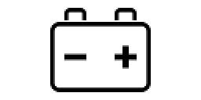

# PreludeExtraGuages

Secondary dashboard controller for the **Honda Prelude IV** (4th gen, 1992–1996).

The factory dashboard of the Prelude IV has a VFD (vacuum fluorescent) panel with
two bar gauges driven by a μPD6232C shift-register driver. This project takes over
that VFD and pairs it with a small OLED screen. Together they show extra engine and
chassis data: oil pressure and temperature, air-fuel ratio, exhaust gas temperature,
brake rotor temperature and battery voltage. An alarm system flashes the screen
and drives an output when a value leaves its safe range.

[](https://www.youtube.com/watch?v=6HGEkpkcAlo)

---

## Contents

- [Features](#features)
- [Display modes](#display-modes)
- [Alarm system](#alarm-system)
- [Hardware](#hardware)
- [Wiring](#wiring)
- [Building and flashing](#building-and-flashing)
- [Configuration and calibration](#configuration-and-calibration)
- [Serial data logging](#serial-data-logging)
- [Project layout](#project-layout)
- [Known limitations](#known-limitations)
- [License](#license)

---

## Features

- Arduino Nano (ATmega328P) controller, built with PlatformIO
- Drives the original Prelude VFD gauges: a 20-segment left gauge and a 7-segment
  right gauge with "C/H" labels, in bar or needle style and with smooth
  segment-by-segment movement
- 128×64 SSD1306 OLED that shows the values as numbers and a logo for each mode
- Four display modes, switched with one button
- Night dimming of the OLED from the car's illumination (dimmer) line
- Alarm system with priorities: it switches to the mode that has the problem,
  inverts and flashes the OLED and drives an alarm output
- Sensors:
  - Battery voltage (resistor divider)
  - Oil pressure: VDO resistive sender, 10–180 Ω
  - Oil temperature: NTC thermistor
  - Air-fuel ratio: lambda sensor through an ADS1115 16-bit ADC
  - Exhaust gas temperature: K-type thermocouple through a MAX6675
  - Brake rotor temperature: MLX90614 contactless IR thermometer
- CSV data logging over USB serial

## Display modes

Press the button to cycle through the modes. After a mode change the OLED shows
the mode logo for 2 seconds, then switches to live values.

| | Mode | Left VFD gauge | Right VFD gauge | OLED |
|---|---|---|---|---|
|  | **Oil** | Bar: oil pressure, 0–10 bar (2 segments per bar) | Bar: oil temperature, stepped (see below) | `x.xxbar` / `xx°C` |
|  | **Exhaust** | Needle: lambda sensor voltage, 0–1 V | Bar: EGT, 100 °C per segment (0–700 °C) | `AFR:x.xx` / `xxx°C` |
|  | **Brakes** | off | Bar: rotor temperature, ~54 °C per segment (0–380 °C) | `Brakes` / `xxx°C` |
|  | **Battery** | Needle: voltage, 8–18 V (2 segments per volt) | off | `Battery` / `xx.xxV` |

Oil temperature on the right gauge, from the "C" end to the "H" end:

| Oil temp | < 40 °C | 40–80 | 80–110 | 110–120 | 120–130 | 130–140 | 140–150 | ≥ 150 °C |
|---|---|---|---|---|---|---|---|---|
| Segments lit | 0 | 1 | 2 (center) | 3 | 4 | 5 | 6 | 7 (red) |

At power-up the OLED shows a Prelude splash screen for 1.5 seconds:


## Alarm system

Every sensor cycle checks all alarm conditions. When an alarm is active:

- the display switches to the mode that has the problem, and the button is
  ignored while the alarm lasts;
- the OLED inverts and flashes;
- `ALARM_PIN` (D5) goes HIGH in sync with the flashing. Use it to drive a buzzer,
  an LED or a relay.

The conditions below are listed from **lowest to highest priority**. When several
are active at once, the last one decides which mode is shown.

| # | Condition | Threshold | Mode shown |
|---|---|---|---|
| 1 | Exhaust gas temperature too high | EGT > 1000 °C | Exhaust |
| 2 | Brake rotor temperature too high | > 351 °C | Brakes |
| 3 | Over-charge | > 15.0 V for more than 2 s | Battery |
| 4 | No charge while the engine runs | < 12.5 V, oil pressure > 1 bar, for more than 2 s | Battery |
| 5 | Oil temperature too high | > 120 °C | Oil |
| 6 | Oil pressure out of range | < 1 bar or > 7 bar, voltage > 12.5 V **and** oil temp > 40 °C | Oil |

The 2-second delay on the battery alarms covers engine cranking. The oil pressure
alarm is only active once the oil is warm, so a cold start does not trigger it.

## Hardware

| Part | Purpose | Interface |
|---|---|---|
| Arduino Nano (ATmega328P, 5 V, 16 MHz) | Controller | — |
| LM2596HV buck converter | 12 V car supply → 5 V | — |
| SSD1306 128×64 OLED | Values and mode logos | I²C |
| ADS1115 | 16-bit ADC for the lambda sensor | I²C (0x48) |
| MLX90614 | Contactless IR brake rotor temperature | I²C (0x5A) |
| MAX6675 + K-type thermocouple | Exhaust gas temperature | Software SPI |
| VDO oil pressure sender (10–180 Ω, 0–10 bar) | Oil pressure | Analog A1 |
| NTC thermistor (~1.4 kΩ @ 25 °C, β≈3500) | Oil temperature | Analog A0 |
| Resistors: 47 kΩ + 10 kΩ, 10 kΩ, ~200 Ω | Voltage dividers | — |
| Momentary push button | Mode switch | D12 (to GND) |
| Original Prelude IV VFD gauge panel (μPD6232C) | Bar gauges | D6–D8 |

## Wiring

### Arduino Nano pinout

```
               +-----------+
               • TX    Vin •
               • RX  A Gnd •  <- GND
               • RST R RST •
        GND -> • GND D  +5 •  <- +5V from LM2596HV
     MAX DO -> • 2   U  A7 •
     MAX CS <- • 3   I  A6 •
    MAX CLK <- • 4   N  A5 • -> OLED / ADS1115 / MLX90614 SCL
      Alarm <- • 5   O  A4 • -> OLED / ADS1115 / MLX90614 SDA
     VFD LH <- • 6      A3 •
    VFD SCK <- • 7   N  A2 • <- Battery, R1/R2 divider
     VFD SI <- • 8   A  A1 • <- Oil pressure, R4 divider
               • 9   N  A0 • <- Oil temperature, R3 divider
               • 10  O Arf •
               • 11    3V3 •
     Button -> • 12 ||| 13 • <- Dimmer
               +-----------+
```

### Pin summary

| Nano pin | Signal | Notes |
|---|---|---|
| A0 | Oil temperature | NTC thermistor with R3 = 10 kΩ |
| A1 | Oil pressure | VDO sender with R4 ≈ 200 Ω from +5 V |
| A2 | Battery voltage | R1 = 47 kΩ / R2 = 10 kΩ divider (max ≈ 28 V input) |
| A4 / A5 | I²C SDA / SCL | Shared by OLED, ADS1115 and MLX90614 |
| D2 / D3 / D4 | MAX6675 DO / CS / CLK | Thermocouple amplifier |
| D5 | Alarm output | Active HIGH, use a transistor for loads |
| D6 / D7 / D8 | VFD LH / SCK / SI | μPD6232C latch, clock and data |
| D12 | Mode button | To GND, internal pull-up |
| D13 | Dimmer input | Active HIGH = dim (see the note below) |

ADS1115 channel **A0** reads the lambda sensor.

> **Dimmer input warning.** The car's illumination line carries **+12 V**. Never
> connect it to D13 directly. Use a voltage divider or an optocoupler that gives
> 5 V. D13 also drives the Nano's onboard LED, which makes the internal pull-up
> unreliable, so add an external pull-up resistor.

### Sensor harness

The wire colors used in the original build are listed in
[`PinOuts.docx`](PinOuts.docx). The harness has separate connectors for the IR
(brake) sensor, EGT, oxygen sensor, oil pressure, oil temperature and the button.

### VFD protocol

The VFD driver is a 44-bit serial-in shift register. On each refresh the
controller does the following:

1. sets LH low;
2. clocks out 44 bits on SI, on the rising edge of SCK;
3. pulses LH to latch the bits.

| Bit index | Element |
|---|---|
| 5–25 | Left gauge segments |
| 26–28 | Left gauge labels |
| 31–37 | Right gauge segments |
| 38, 41 | Right gauge frame |
| 39, 40, 42, 43 | Right gauge "C" / "H" letters |

## Building and flashing

The project uses [PlatformIO](https://platformio.org/). PlatformIO installs the
libraries listed in `platformio.ini` automatically:

- `olikraus/U8glib`
- `adafruit/Adafruit ADS1X15`
- `siruli/MAX6675`
- `adafruit/Adafruit MLX90614 Library`

```bash
# build
pio run

# build and upload (PlatformIO detects the port automatically)
pio run -t upload

# open the serial monitor at 115200 baud
pio device monitor
```

If PlatformIO picks the wrong port, uncomment `upload_port` in `platformio.ini`
and set your port there, for example `COM7` or `/dev/ttyUSB0`.

> The firmware uses about **73%** of the Nano's flash (about 22.5 KB of 30 KB).
> Disabling `DATALOG_ENABLE` frees another ~1.5 KB.

## Configuration and calibration

All settings are `#define`s at the top of [`src/Gauges.cpp`](src/Gauges.cpp).

### Sensors

| Define | Default | Meaning |
|---|---|---|
| `R1`, `R2` | 47000, 9950 | Battery divider resistors in Ω. Measure them and enter the real values. |
| `R3` | 9920 | Resistor in the oil temperature divider, Ω |
| `THERMISTOR_NOMINAL` | 1400 | NTC resistance at `TEMPERATURE_NOMINAL`, Ω |
| `TEMPERATURE_NOMINAL` | 25 | Reference temperature for the NTC, °C |
| `B_COEFFICIENT` | 3500 | NTC β coefficient |
| `R4` | 199 | Resistor in the oil pressure divider, Ω |
| `MIN_OHM_PRESS` / `MAX_OHM_PRESS` | 10 / 180 | Sender resistance at 0 bar / full scale |
| `OIL_SENSOR_TYPE` | 10.0 | Full-scale pressure of the sender, bar |

Oil temperature is calculated with the β-parameter equation. Oil pressure is
calculated by linear interpolation of the divider voltage between
`MIN_OHM_PRESS` and `MAX_OHM_PRESS`. All three analog channels go through an
exponential low-pass filter (α = 0.1).

### Alarms

| Define | Default | Meaning |
|---|---|---|
| `ALARM_EGT` | 1000 | EGT limit, °C |
| `ALARM_OIL` / `ALARM_OIL_HIGH` | 1 / 7 | Oil pressure window, bar |
| `ALARM_TEMP` | 120 | Oil temperature limit, °C |
| `WORK_TEMP` | 40 | Oil pressure is checked only above this oil temperature, °C |
| `ALARM_BRAKES` | 351 | Brake rotor temperature limit, °C |
| `ALARM_BATTERY_LOW` / `ALARM_BATTERY_HIGH` | 12.5 / 15.0 | Charging voltage window, V |
| `ALARM_BETTERY_DELAY` | 2000 | Delay before a battery alarm, ms |

### Timing

| Define | Default | Meaning |
|---|---|---|
| `OLED_DELAY` | 100 | OLED refresh period, ms (also the alarm flash rate) |
| `LOGO_DELAY` | 2000 | How long the mode logo stays on screen, ms |
| `EGT_DELAY` | 250 | MAX6675 polling period, ms (one conversion takes ≤ 220 ms) |
| `LOG_DELAY` | 1000 | Serial log period, ms |

### Mode logos

The logos are monochrome XBM images stored in PROGMEM in
[`lib/img/img.h`](lib/img/img.h). The full-size 128×64 sources are in
[`icons/`](icons/), as BMP and XBM files.

To save flash, each logo in `img.h` is cropped to its content. Four defines give
its position and size on the 128×64 screen: `<name>_X`, `<name>_Y`, `<name>_W` and
`<name>_H`. `DRAW_LOGO(name)` draws the logo at that position.

To change a logo:

1. Draw a new 128×64 1-bit image.
2. Crop it to the content and note the offset of the crop.
3. Export the cropped image as XBM.
4. In `img.h`, replace the array and update the four defines.

## Serial data logging

When `DATALOG_ENABLE` is defined (the default), the controller prints one CSV line
per second at **115200 baud**:

```
Ab0VE-TECH Honda Prelude Gauges contoller
TIME, OIL_T, OIL_P, VOLT, AFR ,EGT, BRAKES, AMBIENT
15023, 87.41, 3.52, 14.12, 0.45, 512.25, 64.33,
```

| Column | Unit |
|---|---|
| `TIME` | ms since power-up |
| `OIL_T` | °C |
| `OIL_P` | bar |
| `VOLT` | V |
| `AFR` | Lambda sensor voltage, V |
| `EGT` | °C |
| `BRAKES` | °C |
| `AMBIENT` | Not logged at the moment. The column stays empty. |

You can capture the log with `pio device monitor` or any serial terminal and open
it in a spreadsheet.

## Project layout

```
.
├── platformio.ini      PlatformIO project (board, libraries, flags)
├── src/
│   └── Gauges.cpp      Firmware: sensors, alarms, OLED and VFD output
├── lib/img/img.h       Mode logos (XBM in PROGMEM)
├── icons/              Logo sources (BMP / XBM)
├── docs/img/           Images used in this README
└── PinOuts.docx        Sensor harness wire colors
```

## Known limitations

- The `AFR` value is the raw lambda sensor voltage (0–1 V), not a calibrated
  air-fuel ratio. For a wideband controller, add a conversion that matches the
  controller's analog output.
- Readings of the MAX6675 below 0 °C, and readings with an open thermocouple, are
  shown as 0.
- Brake temperatures above 380 °C are treated as invalid and shown as 0.
- The OLED font (`u8g_font_fub20r`) is ASCII-only, so the degree sign is drawn
  as a small ring by `printDegreesC()`.

## License

**PreludeExtraGuages** is distributed under the
[GNU General Public License v3.0](LICENSE).
